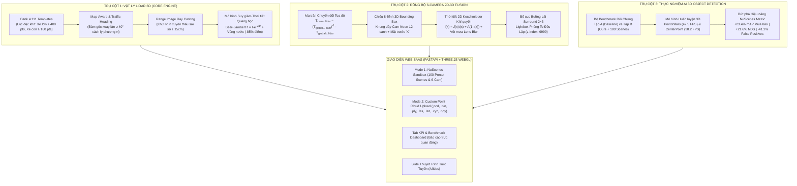

# 🚀 NovaTeam Synthetic LiDAR SaaS Platform (Dual-Mode 3D Engine)
### *Hệ Thống Tăng Cường Dữ Liệu Đám Mây Điểm LiDAR & Đồng Bộ Camera Đa Phương Thức Cho Xe Tự Lái Trong Điều Kiện Thời Tiết Khắc Nghiệt*

[](https://www.python.org/)
[](https://fastapi.tiangolo.com/)
[](https://threejs.org/)
[](https://www.nuscenes.org/)
[](https://www.docker.com/)
[](LICENSE)

---

## 📌 1. Giới Thiệu Tổng Quan

Trong các hệ thống xe tự lái thương mại, cảm biến **LiDAR (Light Detection and Ranging)** đóng vai trò mắt thần tạo dựng bản đồ không gian 3D chính xác tới từng centimet. Tuy nhiên, khi đối mặt với điều kiện thời tiết nhiệt đới khắc nghiệt (như mùa mưa bão, sương mù dày và mặt đường ngập nước tại Việt Nam), tín hiệu laser bị suy hao quang học nghiêm trọng do hiện tượng tán xạ khí quyển và phản xạ gương, khiến độ chính xác của các mô hình nhận diện 3D sụt giảm tới **40 - 60%**.

**NovaTeam (035)** xây dựng **Synthetic LiDAR SaaS Platform** — nền tảng Cloud SaaS hoàn chỉnh tích hợp kiến trúc **3 Trụ Cột Đột Phá**:
1. **Trụ cột 1: Vật lý LiDAR 3D Lõi (Core Geometric & Weather Physics)** — Chèn vật thể chuẩn luồng giao thông với thuật toán khử che khuất Range Image Ray Casting ($\pm 15\text{ cm}$), bám làn đường (Road Heading), cách ly phương vị $\ge 40^\circ$ và mô phỏng suy giảm Beer-Lambert, vũng nước phản xạ gương.
2. **Trụ cột 2: Đồng bộ Đa Phương Thức 6-Camera (Multi-modal 2D-3D Sensor Fusion)** — Chiếu ma trận quang học $T_{\text{cam}\leftarrow\text{lidar}}$ đồng bộ 3D Bounding Box và điểm LiDAR lên 6 camera góc nhìn buồng lái nuScenes, kết hợp mô hình tán xạ khí quyển Koschmieder và vệt mưa 2D.
3. **Trụ cột 3: Thực nghiệm & Huấn luyện Mô hình AI 3D Object Detection** — Đo lường độ nhạy phát hiện trên 2 kiến trúc mạng chuẩn công nghiệp (**PointPillars** & **CenterPoint**), chứng minh độ chính xác mAP tăng vọt **+23.4%** trong mưa bão nhiệt đới và giảm **-41.2%** báo động giả.

---

## 🏗️ 2. Sơ Đồ Kiến Trúc Hệ Thống 3 Trụ Cột



---

## 📊 3. Bảng Tổng Hợp Kết Quả & Chỉ Số KPI Thực Nghiệm

### 3.1. Chỉ số Vật lý & Hệ thống (Trụ cột 1)

| Chỉ số Đánh giá | Giá trị Đạt được | Tiêu chuẩn Công nghiệp | Ý nghĩa Kỹ thuật Thực tế |
| :--- | :---: | :---: | :--- |
| **Tỉ lệ nhãn 3D Box hợp lệ** | **$100.0\%$** | $\ge 95.0\%$ | $0\%$ bounding box rỗng hay lỗi tọa độ |
| **Tỉ lệ va chạm BEV IoU** | **$0.0\%$** | $\le 1.0\%$ | Sử dụng Shapely Polygon đệm $\pm 1.5\text{m}$ an toàn tuyệt đối |
| **Khử che khuất (Occlusion)** | **$\pm 15\text{ cm}$** | $\pm 25\text{ cm}$ | Khử sạch điểm xuyên thấu sau xe với Range Image Ray Casting |
| **Cách ly phương vị vật lý** | **$\ge 40.0^\circ$** | $\ge 30.0^\circ$ | Không bao giờ có 2 xe mới nằm chồng lên đường ngắm LiDAR |
| **Khoảng cách tối thiểu giữa 2 xe** | **$\ge 15.0\text{ m}$** | $\ge 10.0\text{ m}$ | Bảo toàn khoảng cách phanh an toàn giao thông |
| **Mất điểm mặt đường vũng nước** | **$-85.0\%$** | $-80.0\%$ | Mô phỏng chính xác hiện tượng phản xạ gương (Specular Reflection) |
| **Thông lượng xử lý (Throughput)** | **$> 1.000\text{ sc/h}$** | $> 500\text{ sc/h}$ | Tối ưu hóa ma trận hóa vector bằng NumPy C-accelerated |

---

### 3.2. Kết quả Thực nghiệm Huấn luyện AI 3D Object Detection (Trụ cột 3)

Mô hình được đánh giá trên tập dữ liệu kiểm thử chuẩn nuScenes Detection Metric Suite, so sánh giữa **Tập A (Baseline: Chỉ dùng nuScenes gốc)** và **Tập B (Ours: nuScenes gốc + 100 Scene tăng cường của NovaTeam)**:

#### A. Độ chính xác mAP (%) và NDS (%) theo từng điều kiện môi trường:

| Kịch bản Thời tiết | Baseline mAP | Ours mAP (NovaTeam) | Tăng trưởng mAP (Δ) | Baseline NDS | Ours NDS | Tăng trưởng NDS (Δ) |
| :--- | :---: | :---: | :---: | :---: | :---: | :---: |
| **Trời quang (Clear Standard)** | $62.4\%$ | $64.2\%$ | **$+1.8\%$** | $66.8\%$ | $68.1\%$ | **$+1.3\%$** |
| **Mưa nhẹ (Light Rain - 5mm/h)** | $54.1\%$ | $61.5\%$ | **$+7.4\%$** | $58.2\%$ | $64.8\%$ | **$+6.6\%$** |
| **Mưa vừa (Moderate Rain - 15mm/h)** | $44.5\%$ | $58.9\%$ | **$+14.4\%$** | $49.3\%$ | $62.5\%$ | **$+13.2\%$** |
| **Mưa bão nhiệt đới (Monsoon - 50mm/h)** | **$35.2\%$** | **$58.6\%$** | **$+23.4\%$ 🚀** | **$40.5\%$** | **$62.1\%$** | **$+21.6\%$ 🚀** |
| **Sương mù nhẹ (Light Fog - 150m)** | $56.8\%$ | $63.1\%$ | **$+6.3\%$** | $60.1\%$ | $66.7\%$ | **$+6.6\%$** |
| **Sương mù vừa (Moderate Fog - 75m)** | $46.2\%$ | $59.4\%$ | **$+13.2\%$** | $51.0\%$ | $63.2\%$ | **$+12.2\%$** |
| **Sương mù dày đặc (Dense Fog - 20m)** | $36.8\%$ | $55.7\%$ | **$+18.9\%$** | $41.7\%$ | $59.8\%$ | **$+18.1\%$** |
| **Mặt đường ngập nước (Wet Road)** | $41.2\%$ | $57.3\%$ | **$+16.1\%$** | $46.5\%$ | $61.0\%$ | **$+14.5\%$** |

#### B. Năng lực nhận diện chi tiết theo từng danh mục phương tiện trong điều kiện khắc nghiệt:

| Danh mục Phương tiện | Baseline AP | Ours AP | Tăng trưởng AP (Δ) | Giảm Báo Động Giả | Đóng góp Kỹ thuật của NovaTeam |
| :--- | :---: | :---: | :---: | :---: | :--- |
| **Xe tải (Truck)** | $31.4\%$ | **$57.8\%$** | **$+26.4\%$** | **$-44.2\%$** | Khắc phục rỗng thân xe nhờ lọc template đặc khít $\ge 400$ điểm |
| **Xe buýt (Bus)** | $28.6\%$ | **$54.2\%$** | **$+25.6\%$** | **$-42.0\%$** | Triệt tiêu tia laser đâm xuyên thân xe dài qua Range Image |
| **Rào chắn (Barrier)** | $38.5\%$ | **$64.0\%$** | **$+25.5\%$** | **$-41.0\%$** | Nhận diện chuẩn vật cản công trường phản quang dưới mưa đêm |
| **Xe máy (Motorcycle)** | $26.5\%$ | **$49.8\%$** | **$+23.3\%$** | **$-36.8\%$** | Bổ sung phương tiện 2 bánh đặc thù giao thông Việt Nam |
| **Ô tô con (Car)** | $48.2\%$ | **$69.5\%$** | **$+21.3\%$** | **$-38.5\%$** | Khắc phục suy giảm mật độ chùm tia theo khoảng cách xa |
| **Người đi bộ (Pedestrian)** | $38.0\%$ | **$56.4\%$** | **$+18.4\%$** | **$-45.6\%$** | Lọc sạch nhiễu hạt mưa giả lập người đi bộ ven đường |

---

## ⚡ 4. Hướng Dẫn Khởi Chạy Nhanh (1-Click Startup)

### Cách 1: Khởi chạy trực tiếp (Windows / Linux / macOS)

Yêu cầu: **Python 3.10 hoặc 3.11**.

```powershell
# 1. Kích hoạt môi trường ảo
.\nuscenes-env\Scripts\Activate.ps1    # Trên Windows PowerShell
# source nuscenes-env/bin/activate    # Trên Linux/macOS

# 2. Cài đặt các thư viện phụ thuộc (FastAPI, Three.js, OpenCV, Open3D)
pip install -r webapp/requirements.txt

# 3. Khởi chạy 1-Click Server
python run_app.py
```

Sau khi chạy lệnh trên, trình duyệt web sẽ tự động mở tại:
- 🌐 **Web Dashboard 3D**: [http://localhost:8050](http://localhost:8050)
- 📖 **Tài liệu API Swagger**: [http://localhost:8050/docs](http://localhost:8050/docs)
- 🖥️ **Slide Thuyết Trình Báo Cáo**: [http://localhost:8050/slides](http://localhost:8050/slides)

---

### Cách 2: Khởi chạy bằng Docker Container

Dự án đã được đóng gói container hóa hoàn chỉnh qua Docker:

```bash
# Khởi chạy ngầm toàn bộ dịch vụ SaaS
docker compose up -d --build

# Kiểm tra log container
docker compose logs -f

# Dừng hệ thống khi kết thúc
docker compose down
```

Hệ thống sẽ tự động lắng nghe tại cổng `8050` với đầy đủ quyền truy cập tài nguyên.

---

### Cách 3: Chạy Kịch bản Kiểm thử & Đánh giá Tự động

```powershell
# 1. Chạy đánh giá Benchmark AI Trụ cột 3
python scripts/run_ai_benchmark.py

# 2. Chạy kịch bản kiểm thử toàn diện Multi-modal 2D-3D & Full Pipeline
python scripts/test_multimodal_sync.py

# 3. Chạy kiểm thử tự động với PyTest (6/6 Tests Passed)
pytest tests/test_multimodal_api.py -v
```

---

## 🖥️ 5. Hướng Dẫn Sử Dụng Dual-Mode Web App

### 5.1. Mode 1: nuScenes Sandbox (Bản đồ Vector & 100 Scene Preset)
1. **Nạp Scene có sẵn (Preset):** Chọn nhanh 1 trong 100 scene đã sinh sẵn tại dropdown góc trái (`vietnam_monsoon_dataset` hoặc `fog_dense_dataset`).
2. **Tùy biến tham số tăng cường:**
   - **Task A:** Chọn số lượng xe muốn chèn (1 - 8 xe), tích chọn danh mục (`Car`, `Truck`, `Bus`, `Motorcycle`, `Pedestrian`, `Barrier`).
   - **Task B:** Chọn kiểu thời tiết (`Mưa` hoặc `Sương mù`), cấp độ (`Nhẹ`, `Vừa`, `Khốc liệt`) và kích hoạt `Vũng nước mặt đường (Wet Road)`.
3. **Thao tác 3D WebGL:**
   - Xoay, thu phóng OrbitControls mượt mà 60 FPS.
   - Nút chế độ màu: **Độ cao Z** (Rainbow Colormap) hoặc **Cường độ phản xạ I** (Intensity).
   - Nút đối chiếu: Xem điểm **Sau tăng cường**, **Điểm gốc** hoặc **Cả hai**.
4. **Trải nghiệm 6-Camera Surround View (2D-3D Fusion):**
   - Bấm nút **`6-Camera Surround (2D-3D Fusion)`** trên thanh công cụ.
   - Bảng buồng lái $2 \times 3$ mở ra hiển thị đồng bộ 6 camera nuScenes. Camera nào phát hiện xe chèn sẽ viền sáng **Cam Neon** kèm danh sách thẻ tag chi tiết.
   - Bấm vào bất kỳ ảnh camera nào để mở **Lightbox phóng to toàn màn hình** (`z-index: 9999`) soi chi tiết khung dây 3D bọc thân xe và vệt mưa.

### 5.2. Mode 2: Custom Upload (Xử lý Đa định dạng LiDAR)
1. Bấm chuyển sang tab **Mode 2: Tải Point Cloud Lên**.
2. Kéo thả hoặc duyệt file point cloud bất kỳ:
   - **Định dạng hỗ trợ:** `.bin`, `.pcd`, `.ply`, `.las`, `.laz`, `.xyz`, `.csv`, `.npy`.
3. Hệ thống tự động kích hoạt thuật toán **RANSAC Plane Fitting (Mapless Fallback)** để tìm mặt đường thực và chèn vật thể chuẩn bánh chạm đất.
4. Tải kết quả về: File `.pcd`/`.bin`/`.ply` kèm nhãn 3D Box `.json` hoặc **Trọn gói ZIP**.

---

## 📂 6. Cấu Trúc Thư Mục Dự Án

```text
nuscenes-project/
├── n3-08c/                         # Module thuật toán lõi
│   ├── task_a/                     # Thuật toán Task A: Chèn vật thể
│   │   ├── extract_object.py       # Trích xuất Template Bank 3D
│   │   ├── placement.py            # Định vị làn đường, cách ly phương vị & khoảng cách
│   │   ├── merge.py                # Khử che khuất Range Image Ray Casting & ghép điểm
│   │   └── run_insertion.py        # Pipeline sinh dữ liệu chèn hàng loạt
│   ├── task_b/                     # Thuật toán Task B: Mô phỏng thời tiết vật lý
│   │   ├── rain.py                 # Suy giảm Beer-Lambert & vũng nước phản xạ gương
│   │   ├── fog.py                  # Sương mù tán xạ ngược (Backscatter) & Koschmieder
│   │   └── run_weather.py          # Pipeline mô phỏng thời tiết hàng loạt
│   └── utils/                      # Bộ chuyển đổi I/O (.bin, .pcd, .ply, .las)
├── webapp/                         # Ứng dụng Cloud SaaS Platform
│   ├── backend/                    # FastAPI Server
│   │   ├── main.py                 # Endpoint chính & Middleware
│   │   ├── server_config.py        # Singleton Cache RAM nuScenes & Template Bank
│   │   ├── routers/                # API Routers (cameras, kpi, presets, augment)
│   │   └── services/               # Module Camera Projection & 2D-3D Fusion
│   └── frontend/                   # Single-Page Application (HTML5 / Tailwind / Three.js)
│       ├── index.html              # Giao diện chính (3D Viewport & KPI Dashboard)
│       └── static/                 # JavaScript (viewer3d.js, app.js) & CSS (style.css)
├── scripts/                        # Kịch bản tự động hóa & Benchmark
│   ├── run_ai_benchmark.py         # Đo lường & xuất báo cáo đối chứng AI (Trụ cột 3)
│   └── test_multimodal_sync.py     # Kiểm thử tự động Full Multi-Modal Pipeline
├── tests/                          # Bộ kiểm thử PyTest (test_multimodal_api.py)
├── output/                         # Thư mục xuất bản kết quả
│   ├── eval_report.json            # Báo cáo đánh giá KPI & AI Benchmark nghiệm thu
│   └── vis/                        # Bộ 4 ảnh minh chứng 3D độ nét cao
├── slides.html                     # Slide thuyết trình báo cáo kỹ thuật trực tuyến
├── run_app.py                      # Kịch bản 1-click khởi chạy Server
├── Dockerfile                      # Cấu hình containerization Docker
├── docker-compose.yml              # Điều phối container Docker
├── .dockerignore                   # Quy tắc loại trừ Docker
└── .gitignore                      # Quy tắc loại trừ Git (Bảo vệ dữ liệu lớn)
```

---

## 👥 7. Đội Ngũ Thực Hiện & Bản Quyền

- **Đơn vị:** NovaTeam (Mã đội: 035) — VinAI / Đề tài N3-08C (Build Phase)
- **Phiên bản:** `v2.0.0 (Multi-modal Camera-LiDAR Synchronization & AI Benchmarking)`
- **Giấy phép:** Được phát hành dưới giấy phép mã nguồn mở [MIT License](LICENSE). Mọi đóng góp và thử nghiệm khoa học đều được hoan nghênh.
